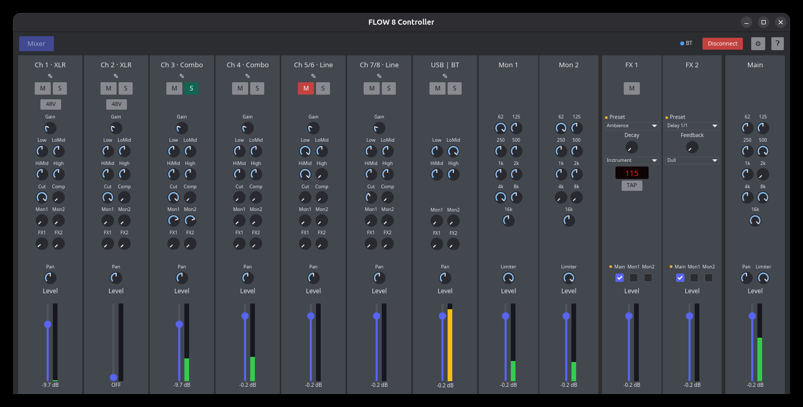

# FLOW 8 MIDI Controller

A non-official cross-platform desktop MIDI controller for the [Behringer FLOW 8](https://www.behringer.com/behringer/product?modelCode=0603-AEW) mixer, in an SSL-style console layout.

Made with [Rust](https://www.rust-lang.org/), [iced](https://iced.rs/), [midir](https://github.com/Boddlnagg/midir) and [btleplug](https://github.com/deviceplug/btleplug).



## About

* **Repository**: [github.com/ipf/flow-8-midi](https://github.com/ipf/flow-8-midi) — fork of [abelroes/flow-8-midi](https://github.com/abelroes/flow-8-midi)
* **Author**: ipf — current maintainer of the fork; original by [Abel Rocha Espinosa](https://github.com/abelroes)

## Download

Pre-built binaries for Linux (x86_64), Windows (x86_64), and macOS (Apple Silicon) are available on the [Releases page](https://github.com/ipf/flow-8-midi/releases) (current release: v2.0.0).

## Features

* **Mixer page**: SSL-style channel strips for all 7 inputs — Gain, 4-band EQ, Low Cut, Compressor, sends (Mon 1/2, FX 1/2), Pan, and a level fader with VU meter per channel. Bus strips with 9-band graphic EQ, limiter, and FX return controls (preset selection, parameters, routing, TAP tempo with 7-segment readout).
* **Settings page**: all back-panel device settings (footswitch, phones, USB streaming, pads, monitor sources) with live BLE read-back highlighting, plus the 15 mixer snapshots (load, save, rename, delete) and theme/sync preferences.
* **BLE sync**: when connected via Bluetooth, reads the mixer's full state (all parameters, snapshot names, device settings) and reflects it in the UI. The nav bar has an explicit Connect/Disconnect button — the label follows the link state.
* **Auto-detection**: automatically detects the FLOW 8 on startup via USB MIDI.
* **Cross-platform**: works on Windows, Linux, and macOS.
* **About page**: app info, in-app manual, and a debug log view with a "Show debug entries" switch (off by default — the log file always captures everything).

## How to Use

1. Download the FLOW 8 MIDI Controller.
2. Connect your FLOW 8 device via USB and power it on.
3. Open the application — the FLOW 8 is detected and connected automatically.
4. Use the **Mixer** page for all channels, buses, and FX; the gear icon (⚙) opens **Settings** (device settings, snapshots).
5. **(Optional)** Connect via Bluetooth to sync the mixer's current state to the UI (see [User Manual](./docs/MANUAL.md#6-bluetooth-ble-sync)).

## Documentation

* **[User Manual](./docs/MANUAL.md)** — Setup, UI pages, BLE sync, and how everything works.
* **[FAQ — Troubleshooting](./docs/MANUAL.md#7-faq--troubleshooting)** — Common issues with Bluetooth, USB, snapshots, and more.
* **[Design](./DESIGN.md)** — UI design: pages, strips, controls, styling.
* **[Developer Manual](./docs/DEV_MANUAL.md)** — Dev-tools, calibration workflow, and CLI tools.
* **[MIDI Implementation Research](./docs/flow8-midi-implementation.md)** — Protocol reverse-engineering details.

## Building from source

### Prerequisites

* [Rust](https://www.rust-lang.org/tools/install) 1.85 or later

Install the required system dependencies:

```bash
# Debian/Ubuntu
sudo apt install libasound2-dev pkg-config libxkbcommon-dev libwayland-dev libdbus-1-dev

# Fedora
sudo dnf install alsa-lib-devel pkgconfig libxkbcommon-devel wayland-devel dbus-devel

# Arch
sudo pacman -S alsa-lib pkgconf libxkbcommon wayland dbus
```

### Build & Run

```bash
cargo run --release
```

### Lint

```bash
cargo clippy --release -- -D warnings
```

### Cross-compilation

```bash
cargo build --release --target x86_64-unknown-linux-gnu
cargo build --release --target x86_64-pc-windows-gnu
cargo build --release --target aarch64-apple-darwin
```

The binary is output to `target/<target>/release/`.

### Creating a release

Push a version tag to trigger automated builds for all platforms via GitHub Actions:

```bash
git tag v1.1.0
git push fork v1.1.0
```

This creates a GitHub Release with binaries for Linux, Windows, and macOS attached automatically.

## Disclaimers

* This application is not official. Any damage (to the unit or any peripherals), misuse or act that avoids warranty is not our responsibility. Use it at your own risk.
* USB is one-way: the app can send commands, but the mixer does not report its state over USB. Bluetooth adds state sync — a full state dump on connect and on manual/auto sync, plus a continuous meter feed for fader positions. Mute/solo changes made on the mixer reflect in the UI instantly (BLE flag push); knobs and other parameters update on dumps, not instantly.
* On Windows, fetching snapshot names via BLE may fail due to a platform-level BLE subscribe limitation (`"The attribute cannot be written."`). Snapshots still load correctly — only the names are unavailable, so all slots will appear unnamed.
* Current and future implementations are limited by the [FLOW 8 MIDI implementation](./docs/flow8-midi-implementation.md) reverse-engineered from the device.
* An alternative for custom control of this unit is [TouchOSC](https://hexler.net/touchosc) — use what works best for you.

## Support the Project

If you find this useful, consider [buying the original author a coffee](https://www.buymeacoffee.com/abelroes) — it keeps the upstream project alive.

## License

[GNU GENERAL PUBLIC LICENSE - Version 3](./LICENSE)
